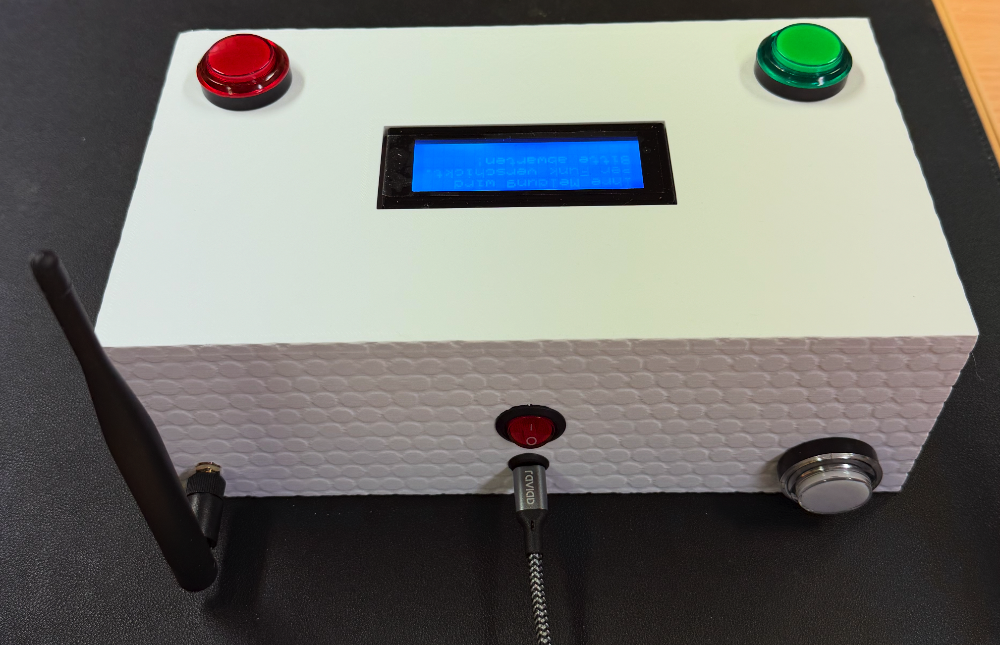

# MERLIN Assist

Prototype of an RDCP v0.4.2026-based device for use in healthcare and assisted living scenarios.

`MERLIN Assist` is a variation of the "big red emergency button" installation deployed in MERLIN Bases in Neuhaus, Austria.

The `MERLIN Assist` devices basically provides three buttons for interaction:

- the red button is used to signal emergencies and request assistance
- the green button is used to signal an "everything is OK" message
- the white button sends a neutral message and can be used for testing whether the device and the LoRa / RDCP connection works

The device includes a small LCD display showing its current status when in use and a speaker playing the same simple melodies as the "big red emergency buttons" in the MERLIN Bases. Its enclosure is large enough to hold a commercial-off-the-shelf powerbank as a battery buffer for blackout scenarios. The device can be charged and operated via a standard USB-C plug similar to smartphones and many other devices.

`MERLIN Assist` sends one of three messages via an RDCP `CITIZEN REPORT` to the MERLIN HQ, depending on which of the three buttons was pressed. It is intentionally kept simple and similar to other devices used in elder care.

The implementation provided here is a simple proof-of-concept for testing purposes only. We created `MERLIN Assist` based on discussions with our project partners in Neuhaus but never had the project resources to turn it into an official work package. None of the steps for a real "product" including certification for use in, e.g., medical settings were considered yet, and thus it should not be relied on in real-world use.

## Building a MERLIN Assist device

- This repository holds STL files for 3D-printing a simple enclosure with a top and a bottom part. The bottom part holds the powerbank or USB-chargeable battery and all other hardware components must be assembled in the top part.

- This repository also holds the PlatformIO firmware project for Heltec LoRa32 V3.2 or V4 devices, based on the plug-in mechanism of our RDCP-Modem implementation. The firmware is the same as in our "big red emergency button for MERLIN Bases" implementation, only adjusted to work with three buttons instead of one and showing the current status on an LCD display.

- We used three 24 mm Arcade-style buttons (red, green, white) for user interaction and a standard 20x4 I2C (VCC, GND, SDA, SCL) LCD display. Pretty much any maker / hobby Arduino-style components will do.

- A standard USB-C socket connects an external USB-C charger to the internal standard powerbank's charging port. The powerbank's output port is connected to the Heltec board via a toggle switch placed on the back of the enclosure. A powerbank should be used that can power the Heltec board both when the external power supply is connected or not. The firmware implementation currently does not make use of the ESP32 deep sleep mode, but still a powerbank must be used that does not power off for lower currents around 0.1 A.

- A standard IPEX-to-SMA connector cable is used to attach an external 868 MHz antenna.

Wiring is simple and can be adjusted in the `rdcp-modem-plugin.cpp` source code file:

- The I2C display must be powered (VCC, GND) and connected to the SDA and SDL pins on the Heltec board.
- The white, green, and red buttons are connected to GND as well as GPIO pins 5, 6, and 7 in our implementation.
- The speaker / buzzer is connected to GND and GPIO pin 1 as in our "big red emergency button" device.

As the number of GND pins on the used Heltec device is embarrassingly low, we soldered copper wire to provide GND where needed. Jumper cables were used to connect to the GPIO pins and fixed in place mechanically.

## Configuring a MERLIN Assist device

Flashing the firmware works as usual with `platformio run --target upload --upload-port /dev/cu.device-name-here`; more details can be found in the RDCP-Modem repository which is the basis for this implementation.

After flashing the firmware, the device needs to be configured or provisioned through its serial (UART/USB-CDC) interface. The same configuration / initscript as for "big red emergency button" devices can be used, so the MERLIN HQ software can treat it exactly as one of these devices. The only practical difference is that the text content of the `CITIZEN REPORT` RDCP messages sent by `MERLIN Assist` devices slightly differs depending on which of the three buttons has been pressed.

When everything has been tested and works, it is recommended to glue the two enclosure parts, so the bottom part with the heavy powerbank does not fall off when lifting the device or dropping it from a desk or nightstand. Project-internal note: Remember it's a fragile prototype for indoor use, not a military ammunition case.

## Using the MERLIN Assist device

- Make sure an 868 MHz antenna is connected.
- Ensure that the device is externally powered or the powerbank is charged.
- Turn on the device using the toggle switch on its back, right above the USB-C socket.
- The device will show on its display that it is ready to operate.
- The display will be turned off after two minutes when not used to conserve energy.
- Pressing any of the three buttons will send the corresponding `CITIZEN REPORT` message. The text shown on the LCD display and the melodies indicate the usual `CIRE state` (waiting for free channel, sending to `Entry Point`, acknowledgment by `Entry Point` received, acknowledgment by MERLIN HQ received, or repeated sending attempts).
- The device has no other functionality but what the three buttons offer. :-)

Troubleshooting:

- If the display does not turn on after power-on of the device, check the wiring and firmware status.
- If none of the `CITIZEN REPORT` messages are properly delivered, check the configuration / provisioning, especially which `Entry Point` has been set. Unlike `MERLIN Messengers`, this device does not yet support automated roaming between MERLIN Bases as it is intended for stationary indoor use.

<!-- EOF -->
